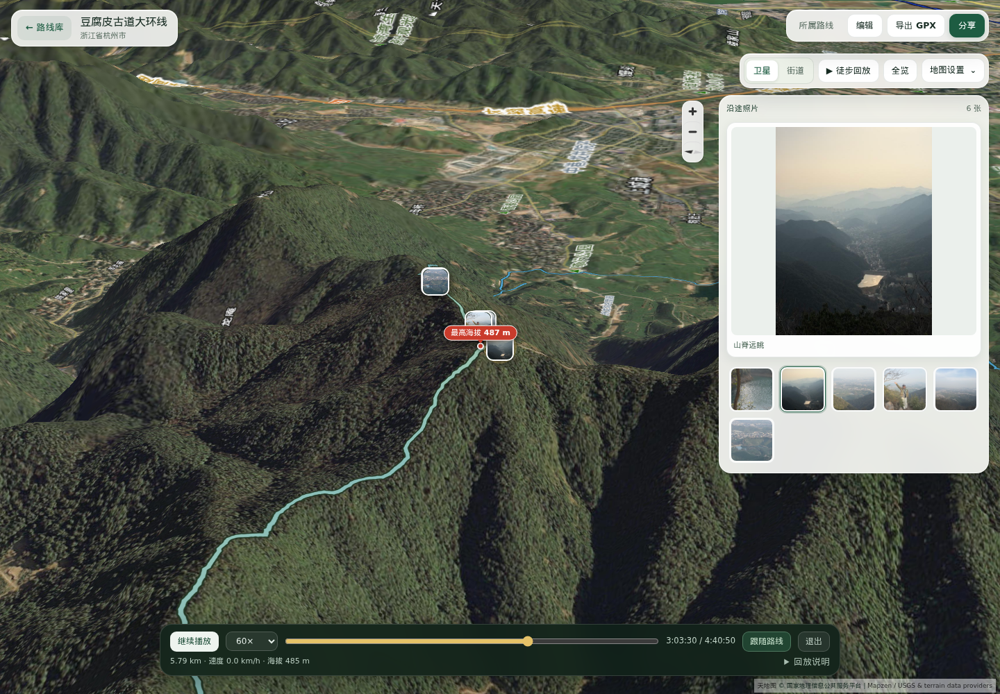
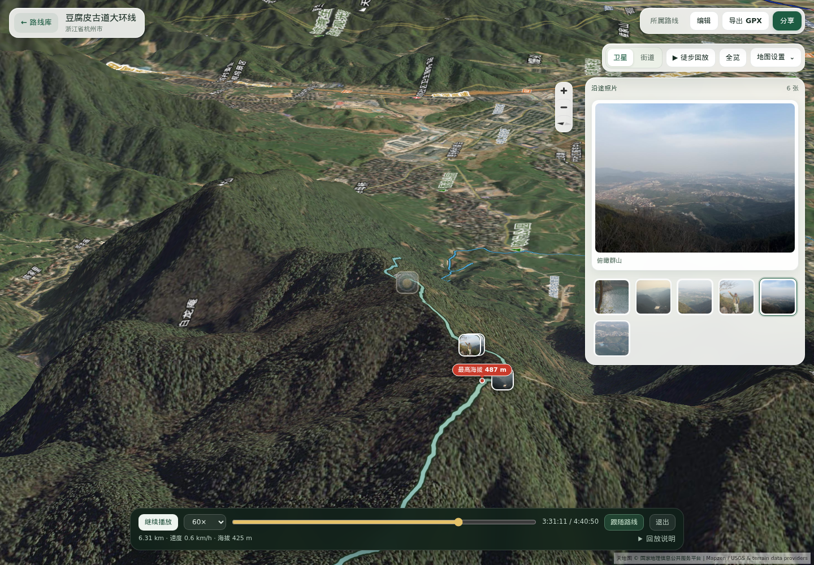
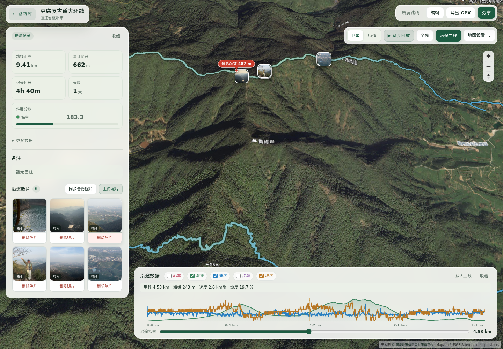
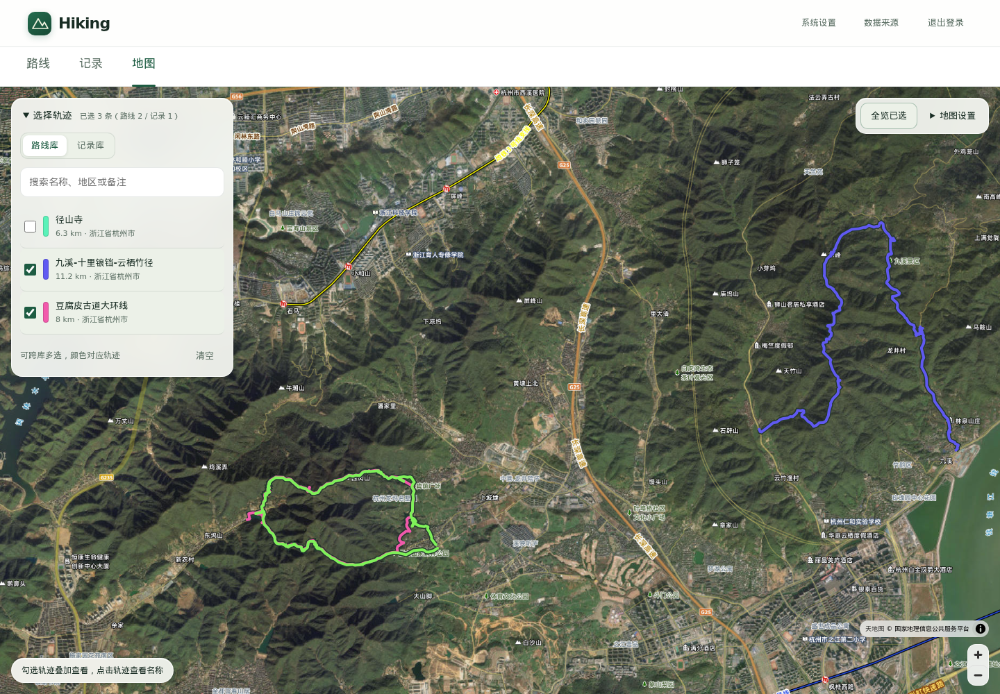
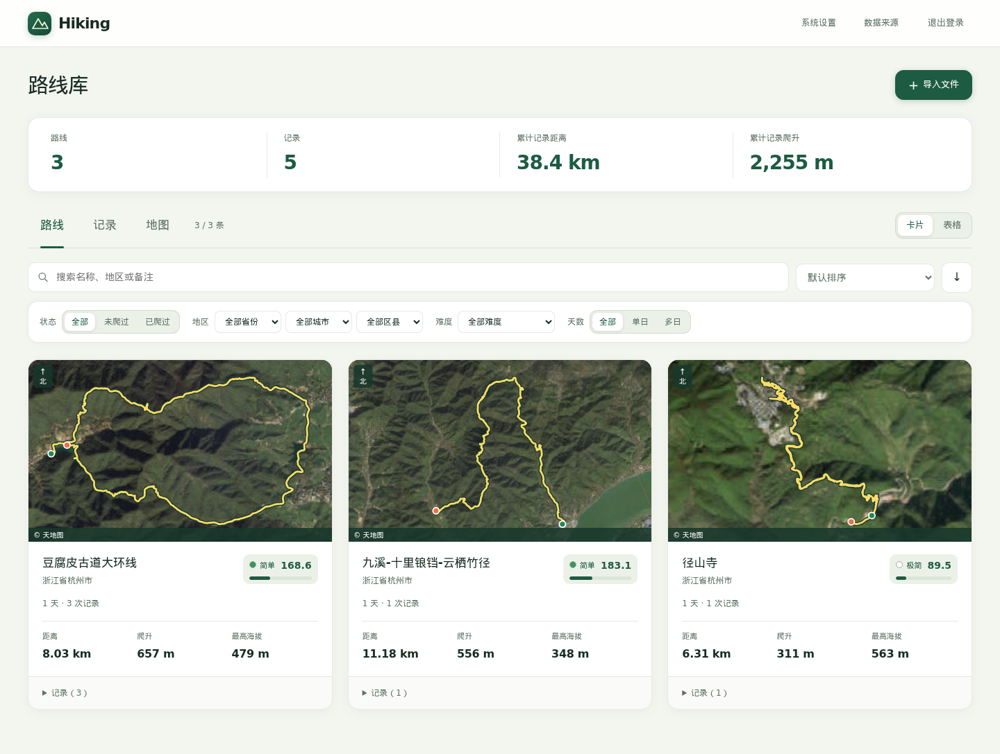

# Hiking · 徒步路线与记录库

Hiking 是一个可自托管的中文徒步日志。用它管理计划路线与实走记录，在地图上对比轨迹，查看海拔和运动数据，并把沿途照片放回拍摄位置。

[功能](#功能) · [截图](#截图) · [快速开始](#快速开始) · [配置](#配置) · [开发与测试](#开发与测试)

## 功能

- **路线与记录**。导入 GPX 或 GeoJSON，关联计划路线与实走记录，按地区、难度和攀爬状态筛选，导出 WGS84 GPX。
- **地图与曲线**。在同一张地图上叠加多条轨迹；进入路线或记录详情后，全屏展示 3D 地形底图，数据统计、沿途照片与海拔、心率、速度、步频、坡度曲线以悬浮卡片形式呈现并支持收起。沿时间轴回放徒步过程，地图、悬浮回放控制条和沿途照片同步定位。
- **照片管理**。上传照片或从服务器备份中按拍摄时间匹配记录。备份同步支持 HEIC 和 Apple Live Photo。
- **分享与移动端**。为单条路线或记录生成限时只读链接。使用 iPhone 快捷指令导入 GPX 或批量上传照片。
- **本地存储**。Python 标准库与 SQLite 提供后端，前端使用原生 JavaScript 和 MapLibre GL JS，无需前端构建。

## 截图

截图取自真实徒步记录，使用天地图卫星影像与 Terrarium 高程数据。图中可辨认的人脸已打码，活动日期和心率等个人信息已隐藏。

### 豆腐皮古道大环线 · 3D 徒步回放

全屏 3D 地形底图下，镜头沿山脊跟随轨迹。走到拍摄点时，右侧悬浮照片卡片自动显示对应的照片，底部悬浮控制条同步展示实时速度与海拔。



<details>
<summary>查看回放继续前进后的照片</summary>



</details>

### 记录详情

全屏地图画布配合可收起的悬浮玻璃面板，依次展示核心统计、沿途照片、顶部工具栏和底部参数曲线。



### 多轨迹地图



### 路线库



## 快速开始

需要 Python 3.11 或更新版本。应用本身无需安装 Python 第三方依赖。

```bash
git clone https://github.com/HBZHSN/hiking.git
cd hiking
python3 -m venv .venv
cp -n .env.example .env
chmod 600 .env
```

编辑 `.env`，把 `HIKING_PASSWORD` 替换为自己的强密码。需要在线地图时，同时填入自己的天地图 `TIANDITU_KEY`。

```bash
./start.sh
```

访问 [http://127.0.0.1:8010](http://127.0.0.1:8010)，用刚设置的密码登录，点击「导入文件」添加 GPX 或 GeoJSON。导入时选择源文件的坐标系，普通 GPS 设备导出的 GPX 通常使用 WGS84。路线库和轨迹统计可在未配置地图 Key 时使用。

## 配置

| 配置项 | 用途 |
| --- | --- |
| `HIKING_PASSWORD` | 登录密码，启动前必填 |
| `HOST`、`PORT` | 监听地址和端口，模板默认 `127.0.0.1:8010` |
| `TIANDITU_KEY` | 可选，启用天地图底图与地区识别。Key 由后端使用 |
| `PHOTO_SOURCE` | 可选，服务器照片备份目录的绝对路径。服务账号需有读取权限 |
| `COOKIE_SECURE` | 通过 HTTPS 反向代理访问时设为 `1` |

配置更新后重启应用。Linux 上可使用 `./deploy/install.sh` 安装用户 systemd 服务，或用 `sudo ./deploy/install.sh` 安装系统服务。安装脚本会启用并启动服务。

### 照片与 iPhone 快捷指令

照片备份同步需要 `exiftool`、`ffprobe` 和支持 HEIC 解码的 `ffmpeg`。可选安装 `vipsthumbnail` 加速缩图。配置备份目录后，在徒步记录详情点击「同步备份照片」。

快捷指令的未签名模板位于 [shortcuts/](shortcuts/)。可在系统设置页按说明手动创建，或在 Mac 上签名后安装。添加时填入自己的服务地址和在「系统设置」生成的上传凭证。

```bash
shortcuts sign --mode anyone --input shortcuts/hiking-gpx-unsigned.shortcut --output shortcuts/hiking-gpx.shortcut
shortcuts sign --mode anyone --input shortcuts/hiking-photos-unsigned.shortcut --output shortcuts/hiking-photos.shortcut
```

### 数据与备份

配置保存在 `.env`，数据库、上传照片与缓存保存在 `data/`。备份时可在应用停机后复制整个 `data/` 和 `.env`，或对运行中的数据库使用 SQLite 的在线备份 API。限时分享链接允许持有者在有效期内查看对应条目的轨迹与照片。

地图使用天地图底图和 Terrarium 地形瓦片，完整数据来源见 [credits.html](credits.html)。

## 开发与测试

后端测试使用临时数据库与模拟外部资源。前端测试需要 Node.js。

```bash
.venv/bin/python -m unittest discover -s tests
npm test
```

提交问题或改进建议时，可以附上复现步骤与脱敏后的示例数据。[GitHub Issues](https://github.com/HBZHSN/hiking/issues)
